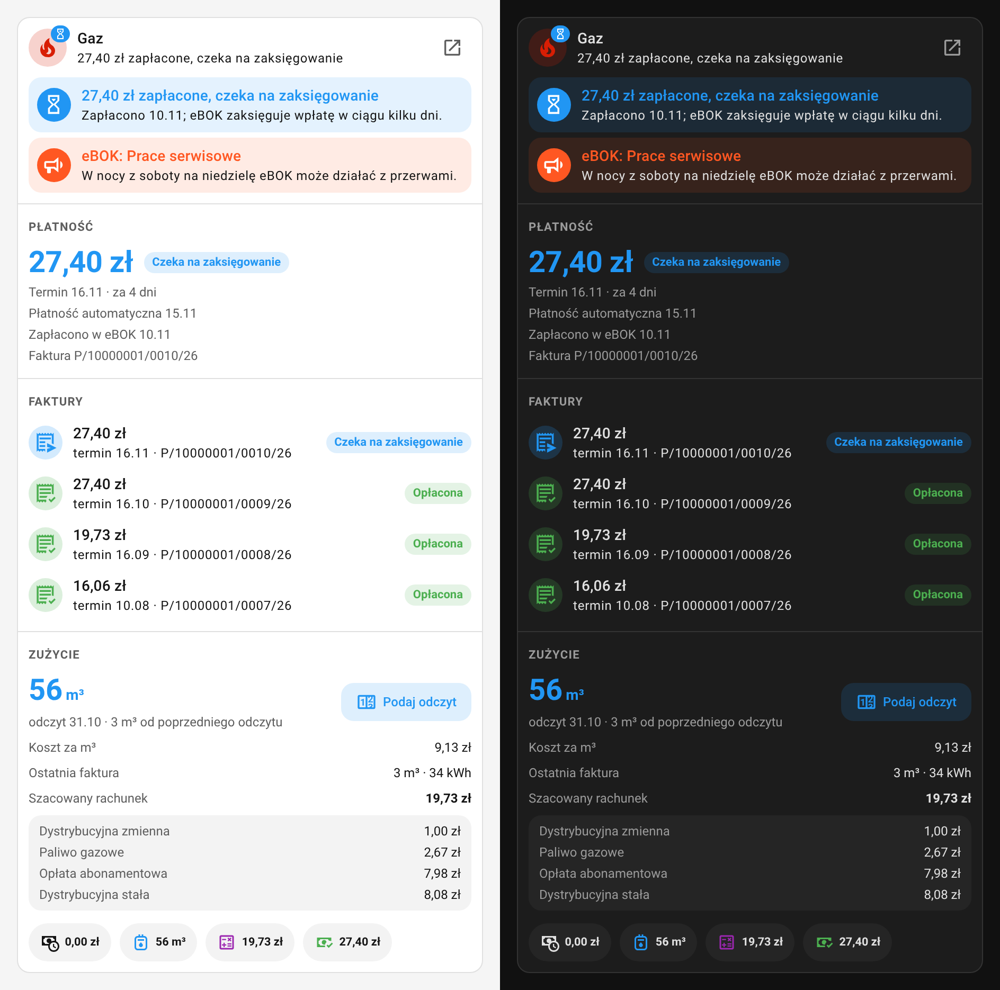
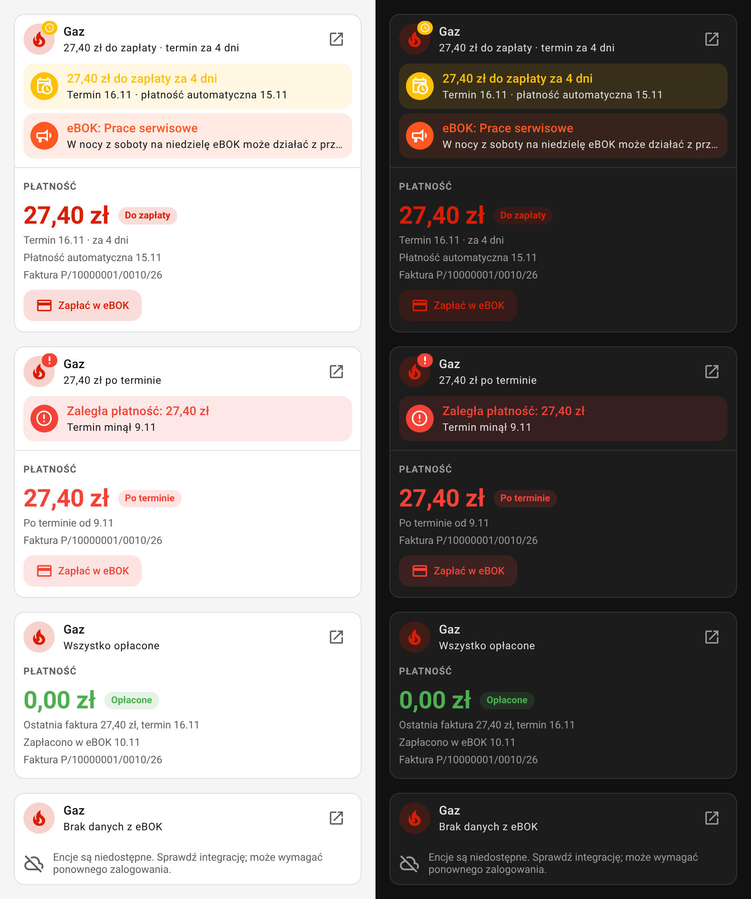
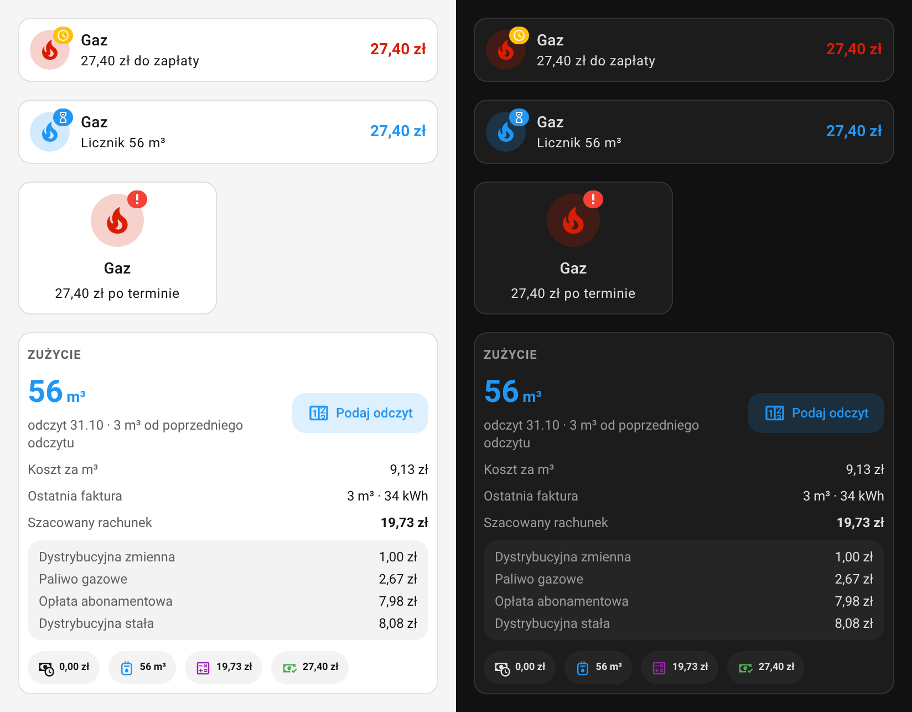
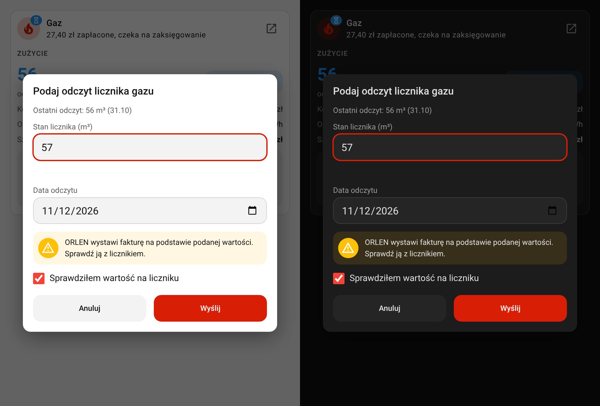

# myORLEN eBOK dla Home Assistant

Nieoficjalna integracja z [eBOK myORLEN](https://ebok.myorlen.pl) (gaz, dawniej PGNiG): stan licznika, faktury ze statusem płatności, kalendarz terminów, saldo, wpłaty, szacowany rachunek, komunikaty eBOK i miesięczne zużycie w statystykach. Pozwala też podać odczyt licznika.

Integracja nie jest powiązana z ORLEN S.A. Korzysta z tego samego API co strona eBOK.

## Instalacja

HACS → *Integracje* → menu ⋮ → *Własne repozytoria* → `https://github.com/KifKick/ha-myorlen-ebok`, kategoria *Integracja*. Zainstaluj **myORLEN eBOK** i zrestartuj Home Assistanta.

Następnie *Ustawienia → Urządzenia i usługi → Dodaj integrację → myORLEN eBOK*.

## Logowanie

- **Login i hasło eBOK** – e-mail lub numer klienta i hasło, jak na stronie eBOK.
- **ORLEN ID** – konto ORLEN ID. Przy pierwszym logowaniu może przyjść kod SMS; integracja zapamiętuje sesję, więc restart Home Assistanta nie wymaga nowego kodu. Co 10 minut odświeża sesję, żeby eBOK jej nie zamknął.

W eBOK integracja widnieje na liście urządzeń jako „Home Assistant”. Gdy sesja wygaśnie, Home Assistant poprosi o ponowne zalogowanie (*Napraw*).

**Opcje**: interwał odświeżania 1–24 h (domyślnie 6 h). Przycisk *Odśwież* i usługa `myorlen_ebok.refresh` pobierają dane od razu.

## Encje

Jedno urządzenie na licznik gazu. Identyfikatory encji: `<platforma>.myorlen_<id licznika>_<nazwa>`, np. `sensor.myorlen_1000001_do_zaplaty`.

| Encja | Opis |
|---|---|
| Odczyt licznika | ostatni odczyt (m³), atrybuty: data, typ i status odczytu, taryfa |
| Data odczytu | kiedy był ostatni odczyt |
| Do zapłaty | suma nieopłaconych faktur; atrybut `awaiting_booking` – kwota zapłacona, ale jeszcze niezaksięgowana |
| Termin płatności | termin najbliższej nieopłaconej faktury, w atrybutach jej szczegóły i data płatności automatycznej |
| Ostatnia faktura | kwota ostatniej faktury; atrybuty: okres, zużycie, stan płatności, data zapłaty, 6 ostatnich faktur |
| Koszt za m³ | kwota ostatniej faktury podzielona przez zużycie (z opłatami stałymi) |
| Saldo | saldo umowy, atrybuty: numer umowy, daty, taryfa |
| Ostatnia wpłata | ostatnia zaksięgowana wpłata, atrybut z 6 ostatnimi |
| Szacowany rachunek | kalkulator eBOK dla ostatniego odczytu: koszt od ostatniej faktury z rozbiciem na paliwo, dystrybucję i abonament. Bez nowego odczytu pokazuje opłaty stałe. Kalkulator tylko liczy, nic nie wysyła |
| Zaległa płatność | włączony, gdy nieopłacona faktura jest po terminie (płatności czekające na zaksięgowanie się nie liczą) |
| Faktury (kalendarz) | wydarzenie w terminie każdej faktury |
| Komunikaty eBOK (zdarzenie) | nowy komunikat z eBOK (awarie, ostrzeżenia), atrybuty `title`, `message` |
| Odśwież (przycisk) | pobiera dane teraz |

### Stan płatności faktury

eBOK oznacza fakturę jako zapłaconą (`IsPaid`) dopiero po zaksięgowaniu wpłaty. Wcześniej, po zapłacie w eBOK, faktura ma status `Paid` i nadal pełną kwotę do zapłaty. Integracja rozróżnia trzy stany: `unpaid`, `awaiting_booking` (zapłacone, czeka na zaksięgowanie) i `paid`.

### Kalendarz

Tytuły wydarzeń:

- `Orlen gaz: 27,40 zł do zapłaty`
- `Orlen gaz: 27,40 zł zapłacone, czeka na zaksięgowanie`
- `Orlen gaz: faktura 27,40 zł opłacona`

W opisie: numer faktury, kwoty, okres, zużycie, data zapłaty w eBOK, data płatności automatycznej, rachunek do przelewu (dla nieopłaconych) i status eBOK. Przypomnienie, które sprawdza „do zapłaty”, pomija faktury już opłacone:

```yaml
triggers:
  - trigger: calendar
    event: start
    entity_id: calendar.myorlen_1000001_faktury
    offset: "-63:00:00"   # 3 dni przed terminem, o 9:00
conditions:
  - condition: template
    value_template: "{{ 'do zapłaty' in trigger.calendar_event.summary }}"
actions:
  - action: notify.notify
    data:
      title: "{{ trigger.calendar_event.summary }}"
      message: "{{ trigger.calendar_event.description }}"
```

### Komunikaty eBOK

```yaml
triggers:
  - trigger: state
    entity_id: event.myorlen_1000001_komunikaty
    not_from: unavailable
actions:
  - action: notify.notify
    data:
      title: "eBOK: {{ trigger.to_state.attributes.title }}"
      message: "{{ trigger.to_state.attributes.message }}"
```

### Zużycie miesięczne

Statystyka `myorlen_ebok:monthly_usage_<numer licznika>` (m³) z miesięcznego zużycia w eBOK (ostatnie 14 miesięcy). Można jej użyć w wykresach statystyk i jako źródła gazu w panelu *Energia*. Jej sumą jest stan licznika; miesiące sprzed ostatniego spadku stanu (poprzedni licznik lub umowa) są pomijane.

## Karta

Integracja ma wbudowaną kartę `custom:myorlen-ebok-card`. Rejestruje ją sama jako zasób panelu przy starcie Home Assistanta, więc nie trzeba niczego doinstalowywać. Po aktualizacji integracji odśwież przeglądarkę (Ctrl+F5).



Dodawanie: panel → *Edytuj* → *Dodaj kartę* → **myORLEN eBOK** (albo z sugestii przy encji licznika). Wszystko ustawisz w edytorze wizualnym; minimalny YAML:

```yaml
type: custom:myorlen-ebok-card
device_id: <urządzenie licznika>
```

Pod nagłówkiem dowolne sekcje w wybranej kolejności:

- `alerts` – komunikaty: zaległa płatność, zbliżający się termin, zapłacone i czeka na zaksięgowanie, komunikat eBOK, brak danych;
- `payment` – kwota ze stanem płatności, termin, płatność automatyczna, data zapłaty w eBOK, przycisk do eBOK;
- `invoices` – ostatnie faktury ze stanem;
- `usage` – stan licznika, koszt za m³, zużycie z ostatniej faktury, szacowany rachunek z rozbiciem i przycisk **Podaj odczyt**;
- `account` – saldo, ostatnia wpłata, taryfa, umowa;
- `stats` – chipy z wybranymi wartościami.



Układy: pełna karta, jeden wiersz (`layout: compact`) i kafelek (`layout: tile`). Wygląd jak w Mushroom (zmienne `--mush-*`), jasny i ciemny motyw, kolor akcentu domyślnie czerwień ORLEN (`--myorlen-rgb-orlen` w motywie).



| Opcja | Domyślnie | Opis |
|---|---|---|
| `device_id` | pierwszy licznik | licznik gazu |
| `name`, `icon` | „Gaz”, `mdi:fire` | nazwa i ikona w nagłówku |
| `layout` | `default` | `default`, `compact`, `tile` |
| `header_info` | `summary` | druga linia: `summary`, `reading`, `balance`, `none` |
| `sections` | `alerts, payment, invoices, usage, stats` | sekcje i ich kolejność |
| `accent_color`, `icon_shape`, `density`, `show_header`, `section_titles` | | wygląd |
| `alerts.types` | wszystkie | `unavailable`, `overdue`, `due_soon`, `awaiting_booking`, `notice` |
| `alerts.due_days` | `5` | ile dni przed terminem pokazać przypomnienie |
| `alerts.notice_days` | `14` | jak długo pokazywać komunikat eBOK |
| `payment.show_pay_link` | `true` | przycisk „Zapłać w eBOK” |
| `invoices.count` | `4` | liczba faktur na liście |
| `usage.show_estimate_parts` | `true` | rozbicie szacowanego rachunku |
| `usage.show_add_reading` | `true` | przycisk „Podaj odczyt” |
| `stats` | `to_pay, reading, estimate, last_payment` | chipy: także `due`, `cost`, `balance` |

Przycisk **Podaj odczyt** otwiera okno z ostatnim odczytem, polem na stan licznika i datą. Wysłanie wymaga potwierdzenia, że wartość sprawdzono na liczniku; wartość niższa od ostatniej albo wyższa o ponad 500 m³ wymaga dodatkowego potwierdzenia.



## Podawanie odczytu

Usługa `myorlen_ebok.add_reading` wysyła stan licznika do eBOK, jak formularz na stronie. **Orlen wystawia fakturę na podstawie tej wartości** – sprawdź ją z licznikiem.

```yaml
action: myorlen_ebok.add_reading
data:
  device_id: <urządzenie licznika>
  value: 57
```

Integracja odrzuca wartość niższą od ostatniego odczytu (chyba że `meter_reset: true` – licznik wymieniony) i wyższą o ponad 500 m³ (chyba że `confirm_large_increase: true`). Odpowiedź mówi, czy odczyt można jeszcze wycofać na stronie eBOK.

## Prywatność

Login, hasło i (dla ORLEN ID) ciasteczka sesji są zapisane w konfiguracji Home Assistanta. Integracja łączy się wyłącznie z ebok.myorlen.pl i stroną logowania ORLEN ID. Diagnostyka ukrywa dane logowania, numery faktur, liczników, umów i rachunków.

## Rozwój

```bash
pip install -r requirements_test.txt
ruff check . && ruff format --check .
pytest
```

Dane testowe w `tests/fixtures` to zanonimizowane odpowiedzi eBOK.
